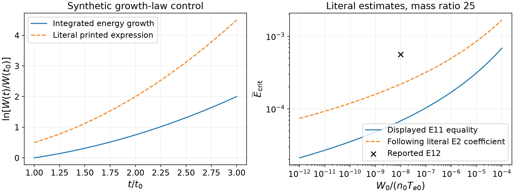
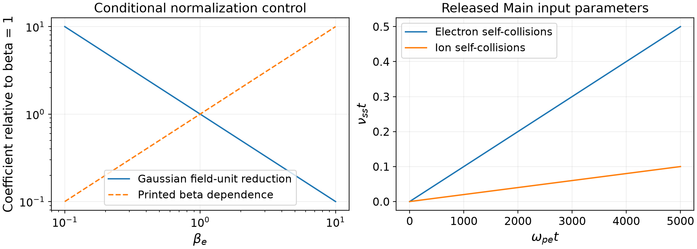

# Growth-law and model consistency in driven ion-acoustic turbulence

**Taylor Kalin**

https://taylorkalin.com ; teylersf@gmail.com  
ORCID: https://orcid.org/0009-0003-9000-9315

Version 1.0.0; 30 October 2026

## Abstract

We audit the growth and normalization formulas in Liu and colleagues' two-dimensional study of current-driven ion-acoustic turbulence, using its complete arXiv v2, current journal article, published erratum and released inputs. Within the article's instantaneous-growth approximation, its time-dependent energy law doubles the integrated exponent. Its later trapping inequality instead agrees with the repaired integration, but the quoted numerical threshold does not solve that displayed inequality at the stated noise level. This discrepancy does not determine a universal physical threshold because order-one trapping-width conventions matter. We also identify displayed species-force, dielectric-reduction and beta-normalization inconsistencies while retaining an exact alternative thermal convention that rescues the stated Maxwellian susceptibility. The released Main input and declared historical solver specify weak self-collisions and a fixed ion source beyond the displayed collisionless equation. A positive-density continuum witness shows why a zero-mean source can do electrostatic work despite zero global particle-kinetic source moments. This is a configuration and budget clarification, not a measured source power or a reproduction of the reported simulations. The source's tabulated normalizations, duration estimate, benchmarks and stated limitations remain credited.

## 1. Scope and existing corrections

Liu et al. [1] study the nonlinear development of ion-acoustic turbulence from initially resting species driven by a weak external electric field. Their two-dimensional Vlasov simulations, comparison with a one-dimensional case and linear/nonlinear resolution checks supply evidence beyond a purely phenomenological account. A mathematical audit should preserve that evidence while distinguishing equations printed in the article from formulas or configurations actually executed.

We read the complete 39-page arXiv:2309.05563v2 and current 39-page publisher article, together with the one-page erratum [2]. The erratum corrects an editorial acknowledgement; the current article already contains that correction. It does not address the scientific points considered here. An institutional cover-plus-article copy also has the same normalized article text as the current publisher copy; it is not the standalone erratum. Exact source hashes and edition correspondence accompany the audit.

The public input directory [3] contains twelve Lua files and its README. That README identifies solver revision `69f26286dcc7`, recovered as full commit `69f26286dcc7640024804ba6b1c5ea16d409f759` in a surviving historical fork [4]. We inspect that declared configuration and relevant source modules. No target executable, complete original run environment, raw distribution histories or plotting scripts are recovered. No result below establishes that a numerical curve is false.

## 2. Integrating the stated time-dependent rate

The article identifies $W$ as wave energy and uses a linear instability rate obtained from its dispersion relation. It then assumes $\gamma(t,k)\simeq\gamma(t_0,k)t/t_0$. Within that instantaneous-rate approximation, write $a=\gamma(t_0,k)/t_0$. The energy equation and its integrated solution are

$$
\frac{d\log W}{dt}=2\gamma(t,k)=2at,\qquad
\frac{W(t)}{W(t_0)}=\exp\!\left[a(t^2-t_0^2)\right].
\tag{1}
$$

Printed Eq. (3.1) instead gives $W(t_0)\exp(2at^2)$. Its logarithmic derivative is $4at$, and it fails its stated anchor at $t=t_0>0$. Reinterpreting the prefactor as an arbitrary integration constant can repair the anchor but leaves the factor of two in the derivative. Interpreting $W$ as a field amplitude would not rescue this coefficient either. This is an internal check of the adopted rate equation, not a derivation of the complete nonautonomous linear Vlasov problem during the current ramp.

The same issue appears in Appendix E. Its Eq. (E1) gives $\gamma(t)=at$, with

$$
a=k\sqrt{\frac{\pi m_e}{8m_i}}\frac{eE_{\rm ext}}{m_e},
\qquad W(t)=W_0\exp(at^2)
\tag{2}
$$

when integration starts at zero. Printed Eq. (E2) has $2at^2$. Twenty-four exact rational controls check the logarithmic derivative and anchor. Independent integration confirms the difference. The postprocessing used for the black dashed curve in source Figure 1 is not supplied by the input directory, so its actual coefficient and fitting error remain unmeasured.

## 3. A retained trapping reduction and a numerical threshold limit

Correcting the integration does **not** require changing every later coefficient. Combining Eq. (2) with the source's saturation and trapping estimates, retaining the half-width in its Eq. (E6), gives precisely the $1/4$ prefactor printed in Eq. (E11). Propagating the literal factor-two exponent in Eq. (E2) would instead give $1/2$. The printed trapping inequality therefore agrees with the repaired growth law.

Let $r=m_i/m_e$, $\eta=W_0/(n_0T_{e0})$, and $\widetilde E=E_{\rm ext}/(4\pi en_0\lambda_{De})$. Since $\lambda_{De}^2=T_{e0}/(4\pi n_0e^2)$, define

$$
S=\frac{E_{\rm ext}^2r}{8\pi n_0T_{e0}}
=\frac r2\widetilde E^2,\qquad
\log\!\left(\frac{\sqrt S}{\eta}\right)=C S^{-1/4},
\quad C=\frac14\sqrt{\frac\pi8}.
\tag{3}
$$

The equality in Eq. (3) is the literal numerical interpretation of source Eq. (E11), not a replacement for its approximate inequality. Setting $z=S^{1/4}$ gives $z\log(z/\sqrt\eta)=C/2$. The positive solution is

$$
\widetilde E_{\rm crit}=\sqrt{\frac2r}
\left[\frac{C}{2\operatorname{W}_0(C/(2\sqrt\eta))}\right]^2,
\tag{4}
$$

where $\operatorname{W}_0$ is the principal Lambert function. Monotone bisection and an independent high-precision implementation agree. For the stated $r=25$ and $\eta=10^{-8}$, Eq. (4) gives $6.8183875047\times10^{-5}$. Substitution of the reported $5.6\times10^{-4}$ instead gives left and right sides $12.19597129$ and $3.52085739$. Propagating the literal Eq. (E2) coefficient gives another value, $2.1910589348\times10^{-4}$, which also does not reproduce the reported number.

These are comparisons of specified formulas. The saturation and trapping estimates contain order-one choices. Increasing the approximate trapping width by a factor $1.86116$ would reconcile the reported field at the same noise because its squared factor multiplies the right side. Noise allocation among modes and width conventions are not calibrated here. We therefore identify a nonreproducible literal numerical estimate, not a universally corrected physical threshold or a refutation of the observed regimes of runs M25E1 and M25E2.

Figure 1. Left: Eq. (1) and the literal printed expression for the synthetic choice $\gamma(t_0)t_0=1/4$. Changing a constant prefactor cannot remove their different slopes. Right: equality estimates for mass ratio 25 as the seed level varies. The second curve propagates the literal doubled exponent. The cross is the reported Eq. (E12), not an independently measured threshold. These curves do not classify the source's nonlinear runs.

## 4. Displayed coefficients and a valid thermal convention

The source's dimensional Eq. (2.2) places the same $E_{\rm ext}$ directly in both species' accelerations, while retaining $q_\alpha/m_\alpha$ on the potential gradient. Its stated physical-field normalization and free-current formula instead require

$$
\boldsymbol a_\alpha=\frac{q_\alpha}{m_\alpha}
(\boldsymbol E_{\rm ext}-\boldsymbol\nabla\varphi),\qquad
\dot J=n_0e^2 E_{\rm ext}\left(\frac1{m_e}+\frac1{m_i}\right)
\tag{5}
$$

for initially uniform, resting, singly charged species. A literal common acceleration gives no relative drift or net-current growth. The source's electron-only expression neglects the small $m_e/m_i$ correction and is consistent with Eq. (5). The released input supplies actual opposite charges and masses; the declared solver multiplies the external field by $q/m$. Thus the displayed omission is not an established implemented force error.

In the reduction from Appendix Eq. (A1) to Eq. (A2),

$$
\frac{ik}{p+ikv_z}=\frac1{v_z-ip/k}.
\tag{6}
$$

The outer $i$ must cancel. Printed Eq. (A2) retains it while defining $F_\alpha$ as the ordinary one-dimensional velocity distribution. A controlled cold-plasma limit gives $\epsilon=1+\omega_p^2/p^2$ after consistent reduction, versus $1+i\omega_p^2/p^2$ from the literal Eq. (A2). The latter has a dispersion root with positive real part $\omega_p/\sqrt2$, whereas the former has oscillatory roots $p=\pm i\omega_p$. This diagnostic exposes the printed algebra; the source's separate linear benchmarks are positive evidence against assuming that its numerical root routine used the defective expression.

Another displayed inconsistency concerns the conclusion's illustrative reconnection-field estimate. Evaluate $\beta_e$, $v_{Te}$ and $\lambda_{De}$ at the same reference temperature ($T_e=T_{e0}$ in the initial field units used here). With conventional $\beta_e=8\pi n_0T_e/B_0^2$ and Gaussian units,

$$
\frac{E_{\rm rec}}{4\pi en_0\lambda_{De}}
=\frac{2\gamma}{\beta_e}\sqrt{\frac{m_e}{m_i}}\frac{v_{Te}}c,
\qquad E_{\rm rec}=\gamma V_AB_0/c.
\tag{7}
$$

This gives the preceding inverse-beta ratio to $E_{\rm NL}$ that the source prints, whereas its next expression multiplies by $\beta_e$. The two normalized-field factors differ by $\beta_e^2$ and coincide at beta one. Unspecified parameters prevent an independent rejection of its quoted numerical field or reconnection-duration comparison. Equation (7) is a normalization clarification, not a new astrophysical calculation.

A tempting further allegation is not forced by the evidence. The Gaussian in source Eq. (3.4) has variance $v_T^2$, and its Eq. (3.5) uses $\zeta=(\omega-ku)/(kv_T)$. The usual Fried–Conte function would use a rescaled argument. But an exact alternative definition is

$$
Z_N(\zeta)=\frac1{\sqrt{2\pi}}\int
\frac{e^{-s^2/2}}{s-\zeta}\,ds
=\frac1{\sqrt2}Z_{\rm FC}(\zeta/\sqrt2).
\tag{8}
$$

With the Landau prescription, $1+\zeta Z_N(\zeta)$ and the stated Debye length give the consistent susceptibility. The source does not explicitly define its Gaussian convention. We request clarification and exclude an unconditional missing-$\sqrt2$ error. Bulk/tail weights can likewise consistently use a common total-density plasma frequency. No population double-counting error is established.

## 5. The released model and its source budget

The released Main input [3] sets $\omega_{pe}=1$, electron and ion self-collision frequencies $10^{-4}$ and $2\times10^{-5}$, no cross-collisions, and an ion source with coefficient $10^{-6}$. Its initial ion perturbation coefficient is $10^{-4}$. The configuration therefore contains terms beyond the displayed source-free collisionless equation. Self-collisions can conserve particle momentum and energy while modifying velocity-space structure; they do not directly supply electron–ion friction. The products $\nu_{ee}t$ and $\nu_{ii}t$ reach $0.5$ and $0.1$ at the nominal end time 5000. These exposures alone neither prove negligible influence nor identify an error in the reported heating.

At the declared historical revision [4], the source module evaluates its profile once at initialization and subsequently adds the stored profile with a default constant time factor. Apparent time dependence inside the Lua profile is therefore evaluated at zero for this clean revision. This is a fixed spatial source, not established white-in-time forcing. The field module explicitly selects a Vlasov–Poisson branch when `hasMagneticField=false`, as in Main. These source semantics identify the declared code path; actual executed-binary identity remains unverified.

Write the continuum source as $S_i=\sigma G(\boldsymbol x)M_i(\boldsymbol v)$, with $G$ a sum of nonzero periodic Fourier modes. Its globally integrated fixed velocity moments vanish. Nevertheless, a self-adjoint periodic Poisson closure gives

$$
U=\tfrac12\langle\rho\varphi\rangle,
\qquad \left.\dot U\right|_S=\langle\varphi S_\rho\rangle.
\tag{9}
$$

For an initial perturbation $\delta f_i=\varepsilon GM_i$ with the same spatial and velocity shape, $S_\rho=(\sigma/\varepsilon)\delta\rho_0$ on nonzero modes and therefore

$$
\left.\dot U(0)\right|_S=2\frac{\sigma}{\varepsilon}U(0)
=0.02\,\omega_{pe}U(0)
\tag{10}
$$

for the Main coefficients. This is an initial continuum contribution, not the total initial growth rate, a measured source power or a claim that the source causes the observed instability. Later $\langle\varphi(t)S_\rho\rangle$ can differ in sign and need not remain proportional to $U(t)$. Discrete projection, zero-mode treatment, exact normalization and actual run outputs must be checked before assigning this term a numerical energy budget. Three positive-density Fourier witnesses reproduce Eq. (10); independent aligned, orthogonal and anti-aligned controls confirm the underlying work identity. Zero injected global particle kinetic energy is insufficient to dismiss electrostatic source work.

Figure 2. Left: the mechanical Gaussian-unit reduction and printed beta dependence, normalized at beta one. Right: accumulated frequency-time products from the released Main constants. Neither panel measures heating, source power or the effect of changing regularization. A collision/source sensitivity study is needed to quantify effects on the nonlinear results.

The source's numerical resolution is not disproved by comparing cell counts with its quoted effective spacing. Main uses polynomial order two; dividing the velocity-cell widths by three gives $0.0208$ and $0.0417$ times the electron thermal speed, compatible with its quoted $0.021$ and $0.042$. This is a plausible degree-count convention, not a proof that DG nodes are uniformly spaced or that all convergence questions are settled.

## 6. Retained results, reproduction and conclusions

All eleven tabulated $E_{\rm NL}$ values follow $(T_{e0}/T_{i0})/(6\pi r)$ in the stated field units to their printed precision. All five theoretical saturation entries follow $W_{\rm sat}/(n_0T_{e0})=\widetilde E\sqrt{r/2}$. The coefficient $28.6/\sqrt2$ rounds to 20.2, and the empirical duration expression gives $\omega_{pe}\tau_{\rm res}=2025$ for Main with final temperature ratio ten, consistent with the quoted roughly 2000. These are positive arithmetic controls, not independent validation of the empirical fits.

A non-Maxwellian central second moment remains a valid pressure measure. Relative bulk/tail drift can broaden a distribution without proving irreversible thermalization. The released input requests `intM2Thermal`; no failure to subtract mean drift is demonstrated. Likewise, the source explicitly discusses finite-box effects, unresolved short modes for M200E10, non-Maxwellian limitations of its stability interpretation and its unobserved ultimate state. Those qualifications remain part of a fair assessment.

The original producer checks 24 exact growth states, 20 threshold states, four species-forcing cases, five beta cases, four denominator identities, cold-limit poles, three Fourier-source witnesses and seven collision exposures. Its three numerical files match between Python 3.12.14 and 3.13.7; NumPy 2.3.5 and Matplotlib 3.11.2 draw the two original figures. Independent exact/high-precision programs are preserved separately and are not imported by the producer. No nonlinear simulation is run.

The supported result is a technical clarification of printed growth and normalization formulas, together with a reproducible statement of additional released-model terms and their possible budget contribution. A revised nonlinear theory, invalid numerical spectrum or false anomalous-resistivity shutdown is not established. Quantifying such claims would require the original diagnostics and controlled collision/source comparisons.

**Availability:** the 50-file computational package is published as software version 1.0.0 at https://doi.org/10.5281/zenodo.23786452 [5]. Public source is frozen at commit `65f92f1fc9c9419a1240fb9a7c658bb1303aae72` in https://github.com/Teylersf/ion-acoustic-turbulence-consistency-audit . The complete archive is 392,029 bytes, SHA-256 `b1d6cb3074bfa050a3d66ced16685bd1991f7a867b5b1ad5e4214487f9c02c4a`. The distinct tested Git tree is `109f70e8192bf1a8bf244b0ca84353e7cd42edf1`; it is not a commit. The software archive excludes the manuscript and original simulation outputs. Original code is MIT licensed; original text and figures are CC BY 4.0. Input-deposit copies retain their exact upstream MIT notice. Historical solver files are not redistributed; their public locators, hashes and our own semantic analysis are supplied. A software DOI or public preprint does not establish manuscript acceptance.

**Funding and disclosures:** Taylor Kalin self-funded this work. No outside funding or competing financial interest was reported. AI systems assisted source comparison, mathematical checking, programming and drafting. Independent internal checks and venue AI review are distinct from external human peer review.

## References

[1] Z. Liu, R. White, M. Francisquez, L. M. Milanese and N. F. Loureiro. A two-dimensional numerical study of ion-acoustic turbulence. Journal of Plasma Physics 90, 965900101 (2024). https://doi.org/10.1017/S0022377824000060 . Supplied preprint: https://arxiv.org/abs/2309.05563v2 . Current publisher article and all appendices inspected.

[2] Z. Liu, R. White, M. Francisquez, L. M. Milanese and N. F. Loureiro. A two-dimensional numerical study of ion-acoustic turbulence—ERRATUM. Journal of Plasma Physics 90, 945900201 (2024). https://doi.org/10.1017/S0022377824000291 . Acknowledgement correction already present in the inspected current article.

[3] Z. Liu and collaborators; Gkeyll Team. Input files for the 2023 ion-acoustic turbulence study. Directory `2023_JPP_iat`, repository `gkeyllorg/gkyl-paper-inp`, commit `7209ddbfe432b1826df3aa1f7f9fa7f32053a3af`. https://github.com/gkeyllorg/gkyl-paper-inp/tree/7209ddbfe432b1826df3aa1f7f9fa7f32053a3af/2023_JPP_iat . Thirteen files verified against Git blobs; this is the article-linked public deposit, not executed-output provenance.

[4] Gkeyll Team. Historical Gkeyll solver source, revision `69f26286dcc7640024804ba6b1c5ea16d409f759`. Public surviving fork: https://github.com/liangwang0734/gkyl/commit/69f26286dcc7640024804ba6b1c5ea16d409f759 . Relevant species-force, source and electrostatic-field modules inspected; solver code is not relicensed or redistributed here.

[5] T. Kalin. Computational evidence for Growth-law and model consistency in driven ion-acoustic turbulence. Software version 1.0.0. Zenodo (2026). https://doi.org/10.5281/zenodo.23786452 . Computational commit `65f92f1fc9c9419a1240fb9a7c658bb1303aae72`.
